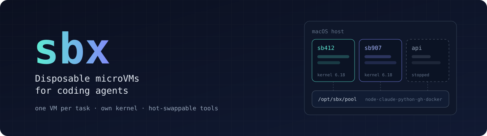
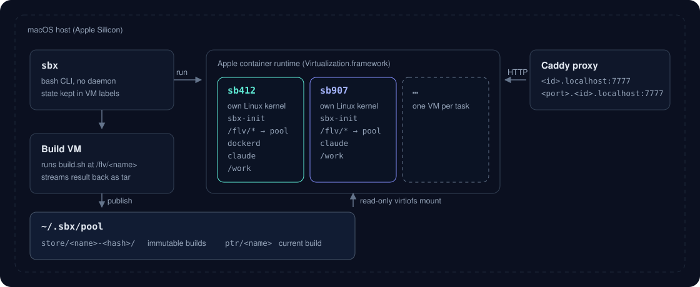

<p align="center">
  
</p>

<p align="center">
  <a href="https://github.com/matthewd-so/agent-sandbox/actions/workflows/ci.yml"></a>
  
  
  <a href="LICENSE"></a>
</p>

<p align="center">
  <a href="#overview">Overview</a> ·
  <a href="#installation">Installation</a> ·
  <a href="#usage">Usage</a> ·
  <a href="#architecture">Architecture</a> ·
  <a href="#flavors">Flavors</a> ·
  <a href="#security-model">Security</a> ·
  <a href="#configuration">Configuration</a>
</p>

---

## Overview

**sbx** runs each coding agent in its own disposable Linux virtual machine,
not on the developer's workstation. Every sandbox boots its own kernel, so an
agent may act as root, install packages, and run Docker without affecting the
host or any other sandbox. Because the VM is the security boundary, agents can
run with interactive permission prompts disabled.

Toolchains are distributed as **flavors**: content-addressed, read-only layers
that are built once, shared by every sandbox, and updated in place. A newly
published build reaches every running sandbox within seconds, with no reboot.

```console
$ sbx new --repo https://github.com/acme/web --claude
==> starting sandbox sb412 (flavor default: node claude python gh docker default, 4 cpu, 4G)
==> cloning https://github.com/acme/web

  sandbox  sb412   (192.168.64.7)
  web      http://sb412.localhost:7777   (any port: http://<port>.sb412.localhost:7777)
  shell    sbx sh sb412
  agent    sbx claude sb412
  remove   sbx rm sb412
```

### Highlights

| | |
| :-- | :-- |
| **Kernel-level isolation** | One microVM per sandbox under Apple's [`container`](https://github.com/apple/container) runtime, each with dedicated CPU and memory limits and its own IP address. |
| **Fast, disposable environments** | A sandbox boots, provisions credentials, and clones a repository in about three seconds. |
| **Shared, hot-swappable toolchains** | Flavors are stored once on the host and mounted read-only into every VM. A rebuilt flavor takes effect in running sandboxes within about three seconds. |
| **Docker inside the sandbox** | A full Docker Engine and Compose run inside the VM, with no privileged host container. |
| **Per-sandbox URLs** | `http://<id>.localhost` and `http://<port>.<id>.localhost` are routed through a loopback-only Caddy proxy. |
| **Agent history retention** | Claude Code transcripts are archived when a sandbox is removed, and can be restored into a new sandbox. |
| **Credential hygiene** | Tokens are copied into the sandbox at creation time. They never appear on the VM command line or in its metadata. |

### Motivation

Coding agents are most productive with broad permissions, and those
permissions are dangerous on a personal machine. Git worktrees isolate source
code but not processes, ports, or installed tools. Containers improve on this,
but containerized projects then need Docker-in-Docker and a privileged
container. A lightweight VM per task removes both problems. Its disposability
also requires that anything worth keeping be persisted deliberately: pushed
to a remote or captured in a flavor.

The design follows Hanmin Kim's
[*The Agent Sandbox*](https://hanmin.dev/blog/agent-sandbox/). That design
uses Cloud Hypervisor on a Linux server. sbx adapts it to run locally on Apple
Silicon.

## Installation

**Requirements:** an Apple Silicon Mac running macOS 26 or later, and
[Homebrew](https://brew.sh).

```sh
brew install container jq caddy
git clone https://github.com/matthewd-so/agent-sandbox ~/agent-sandbox
ln -s ~/agent-sandbox/sbx /opt/homebrew/bin/sbx

sbx init   # start the runtime; build the base image and default flavors
sbx auth   # store a Claude Code token or API key, and optionally a GitHub token
```

To get a long-lived Claude Code token, run `claude setup-token` on the host.

## Usage

### Creating sandboxes

```sh
sbx new                              # empty sandbox, default flavor
sbx new --repo <url>                 # clone a repository into /work
sbx new --mount ./project            # share a host directory read-write
sbx new -n api -f node --cpus 2 --memory 2G --port 8080
sbx new --history sb412              # restore an earlier sandbox's agent history
sbx new --repo <url> --claude        # create, then start Claude Code immediately
```

### Command reference

| Command | Description |
| :-- | :-- |
| `sbx new [options]` | Create and provision a sandbox |
| `sbx ls` | List sandboxes with state, flavor, IP address, and resources |
| `sbx sh <id>` | Open a login shell as the `agent` user in `/work` |
| `sbx exec <id> <cmd…>` | Run a single command |
| `sbx claude <id> [args…]` | Run Claude Code with permission prompts disabled |
| `sbx url <id> [port]` | Print a sandbox's web address |
| `sbx start` / `stop <id…>` | Resume or suspend sandboxes, keeping their disks |
| `sbx rm [--no-backup] <id…>` | Archive agent history, then delete sandboxes |
| `sbx logs <id>` | Show init and flavor-hook logs |
| `sbx flavor <subcommand>` | Build, inspect, roll back, and garbage-collect flavors |
| `sbx history [save <id>]` | List archived agent histories, or save one now |
| `sbx proxy start\|stop\|status` | Manage the local web proxy |
| `sbx auth [--show]` | Store or inspect the credentials given to new sandboxes |

Inside a sandbox, the `agent` user has passwordless `sudo`, the project lives
in `/work`, and Docker can be used without `sudo`.

## Architecture

<p align="center">
  
</p>

- **CLI.** `sbx` is a dependency-light Bash program with no background
  daemon. Each sandbox's configuration is stored in its container labels, so
  host-side state cannot drift from the runtime's.
- **Guest init.** `sbx-init` is the first process in every VM. It links
  flavors, runs lifecycle hooks, and watches for updates.
- **Build VMs.** Flavors are built in short-lived VMs at the same path at
  which sandboxes later mount them, so absolute paths embedded by installers
  remain valid. Output returns to the host as a tar stream.
- **Proxy.** Caddy's configuration is regenerated whenever sandboxes are
  created, started, stopped, or removed.

### Live updates

All builds are kept in `~/.sbx/pool`, which is mounted read-only into every VM
at `/opt/sbx/pool`:

```
pool/
├── store/
│   ├── claude-1a2b3c4d5e6f/   immutable build output
│   └── node-5008e72d3bdd/
└── ptr/
    ├── claude                 name of the current build
    └── node
```

Inside each VM, `/flv/<flavor>` is a symlink to the current build. `sbx-init`
polls `ptr/` every two seconds. When a pointer changes, it runs the outgoing
build's `down` hook, atomically re-points the symlink, and runs the incoming
build's `up` hook. New shells use the new version immediately. Long-running
processes keep using the previous version until they restart.

The pointer indirection exists because Apple's virtiofs implementation does
not reliably expose host-side renames or symlink replacements to the guest,
whereas newly created paths and in-place writes appear at once. Builds are
therefore always written to fresh directories, and the only symlink ever
swapped is inside the guest.

## Flavors

A flavor is a directory under `flavors/`:

```
flavors/claude/
├── flavor       DESC="Claude Code"   DEPS="node"
├── build.sh     installs into $OUT inside a throwaway build VM
├── env.sh       sourced by login shells; $FLAVOR_DIR points at the build
└── hooks/
    ├── up       run as root at boot and after each update   (optional)
    └── down     run as root before shutdown and each update (optional)
```

Each sandbox uses one flavor together with its transitive dependencies.

| Flavor | Provides | Depends on |
| :-- | :-- | :-- |
| `node` | Node.js (latest LTS) and npm | — |
| `claude` | Claude Code | `node` |
| `python` | uv and a managed CPython 3.13 | — |
| `go` | Go toolchain (latest stable) | — |
| `gh` | GitHub CLI | — |
| `docker` | Docker Engine and Compose, started by an `up` hook | — |
| `default` | A complete agent environment | `claude` `python` `gh` `docker` |

```sh
sbx flavor ls                        # status of every flavor
sbx flavor build go                  # build a flavor and its dependencies
sbx flavor build --refresh claude    # rebuild with the latest upstream release
sbx flavor build --all
sbx flavor rollback claude           # republish the previous build
sbx flavor check                     # validate the dependency graph (run in CI)
sbx flavor gc                        # delete unreferenced builds
```

Builds are content-addressed. A flavor is rebuilt only when its own files,
its dependencies' builds, or the base image definition change, or when
`--refresh` is given. To keep custom flavors outside this repository, set
`SBX_EXTRA_FLAVORS` to one or more directories.

## Security model

- **Boundary.** Isolation comes from the VM. Root inside a sandbox has all
  Linux capabilities, but only over that VM's kernel.
- **Shared toolchains.** The flavor pool is mounted read-only in every
  sandbox.
- **Host mounts.** `--mount` gives the agent read-write access to the chosen
  host directory. Use `--repo` when direct host access is not needed.
- **Network.** Sandboxes have the same outbound network access as the host.
  The web proxy binds only to `127.0.0.1`.
- **Credentials.** Every new sandbox receives the credentials saved with
  `sbx auth`. Use narrowly scoped tokens, such as a fine-grained GitHub token
  limited to the repositories in use.

## Configuration

| Variable | Default | Purpose |
| :-- | :-- | :-- |
| `SBX_HOME` | `~/.sbx` | Flavor pool, history archives, credentials, proxy state |
| `SBX_CPUS` | `4` | vCPUs per sandbox |
| `SBX_MEMORY` | `4G` | Memory per sandbox |
| `SBX_DEFAULT_FLAVOR` | `default` | Flavor used when `-f` is omitted |
| `SBX_DEFAULT_PORT` | `3000` | Port served at `http://<id>.localhost` |
| `SBX_PROXY_PORT` | `7777` | Local proxy port |
| `SBX_PROXY_AUTO` | `1` | Start the proxy automatically on first use |
| `SBX_EXTRA_FLAVORS` | — | Additional flavor directories, separated by `:` |

## Limitations

- VM resources are fixed at creation. The runtime does not support memory
  ballooning or CPU overcommit.
- Only command-line tools are provided. There is no graphical desktop or
  computer-use integration.
- Sandboxes run on the local machine only. Because every runtime call is
  isolated in the CLI, porting the same layout to Cloud Hypervisor on a
  remote Linux host would mainly mean replacing the `container` invocations.

## License

Released under the [MIT License](LICENSE).
